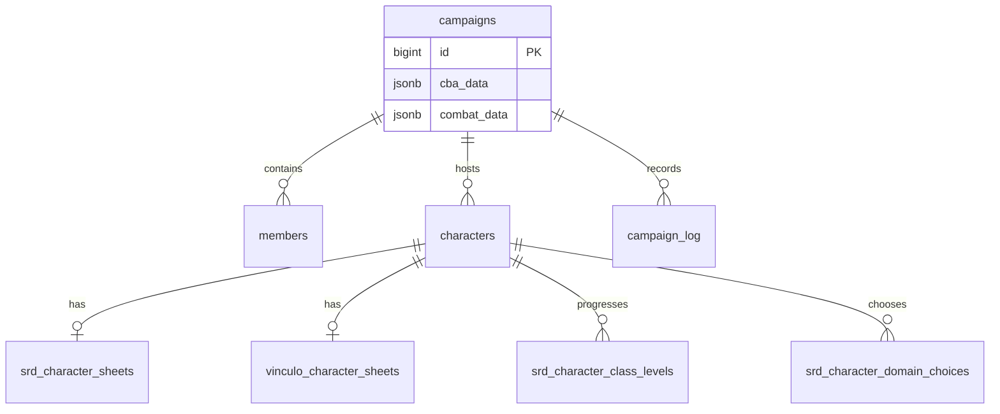

# Vínculo RPG — Modelo de dados e fontes canônicas

> Fotografia somente de leitura de 2026-11-08. Este documento distingue dados ativos, estruturas de compatibilidade e estruturas sem consumidores encontrados. Não é autorização para remover ou migrar tabelas.

## 1. Identidade e regras de personagem

- `characters` é a identidade/posse do personagem e seu vínculo opcional à campanha.
- `campaigns` é o agregado de sessão/campanha.
- `members` registra papel por campanha e usuário.
- `srd_character_sheets` é a ficha D&D 3.5 vinculada a `characters`.
- `vinculo_character_sheets` é a ficha do ruleset Vínculo, separada da ficha SRD.
- O vínculo entre characters e cada ficha específica é por `character_id`; as tabelas de ficha usam chave única/primária e FK para characters. Equipamento e instâncias de arma usam `character_id` text sem FK; são referências lógicas, não relações garantidas pelo banco.
- `characters.campaign_id` pode ser NULL. Isso permite fichas-modelo do Mestre/NPCs que são vinculadas a tokens CBA sem serem personagens de jogador associados diretamente à campanha.
- A restrição única em (campaign_id,user_id) representa atualmente um personagem principal por usuário/campanha. O impacto disso em múltiplos personagens por jogador deve ser uma decisão explícita de produto.

## 2. Fontes de estado da mesa

| Informação | Fonte atual observada | Compatibilidade/legado |
|---|---|---|
| Cena, mapa e tokens CBA | `campaigns.cba_data` JSONB | `scenes`, `tokens`, `monster_instances` |
| Combate, turno e ordem | `campaigns.combat_data` JSONB | `combat_state` |
| Chat e eventos | `campaign_log` | `roll_log` e `roll_requests` |
| Rolagem 3D | `dice.html` via iframe/postMessage | RPC `roll_dice` gera dados no servidor e não é chamado pelas páginas ativas |
| Condições e efeitos de campanha | `srd_campaign_conditions`, `srd_campaign_effects` | resolvers aceitam também alvos do modelo relacional `tokens` |

Contagens observadas: campaigns=3, scenes=3, tokens=0, monster_instances=0, combat_state=0, roll_requests=0, roll_log=0 e campaign_log=70. `create_campaign` ainda insere uma linha em `scenes`, mas a mesa atual não consulta essa tabela diretamente na varredura.

**Decisão provisória:** o caminho ativo é CBA JSONB + campaign_log + Dice iframe. As estruturas relacionais antigas permanecem até confirmar todos os consumidores externos e concluir plano de migração.

## 3. Dados D&D 3.5

### Fontes ativas identificadas

| Domínio | Fonte/estrutura | Uso observado |
|---|---|---|
| Atributos e identidade | `srd_character_sheets.atributos`, `identidade` (JSONB) | ficha, cálculos e requisitos |
| Perícias | `srd_character_sheets.pericias` (JSONB) | salvar/validar graduações e resolver testes |
| Talentos | `srd_character_sheets.talentos` (JSONB) | validar e aplicar modificadores |
| Progressão de classe | `srd_character_class_levels` | BBA, níveis por classe, características e cálculos |
| Domínios | `srd_character_domain_choices` | escolha e acesso a magias de domínio |
| Equipamento | `srd_character_equipment` | inventário equipado, CA, proficiência e armas |
| Instâncias de armas | `srd_character_weapon_instances` | mão, empunhadura e ataques iterativos |
| Recursos de classe | `srd_character_feature_resources` | usos de Fúria e outras habilidades |
| Estado de magia | `srd_character_sheets.magias_preparadas` (JSONB versionado) | conhecidas, preparadas e usos; lido/escrito por salvar_grimorio_srd e resolvers |
| Grimório de progressão | `srd_character_spellbook` | consultado pelo núcleo de avanço de nível |

Contagens observadas: 5 fichas SRD; 5 linhas em class_levels; 42 itens de personagem; 6 instâncias de arma; 0 linhas em domain_choices, feature_resources, spellbook, known_spells, prepared_spells, spell_slot_state e token equipment.

### Estruturas sem uso atual encontrado

A varredura das definições de funções e do frontend não encontrou referências a:
- `srd_character_known_spells`
- `srd_character_prepared_spells`
- `srd_character_spell_slot_state`
- `srd_character_sheets.magias_conhecidas`
- `srd_character_sheets.pericias_treinadas`

`srd_character_spellbook` aparece no núcleo de avanço de nível, mas não tem linhas no snapshot. Essas estruturas podem representar uma tentativa de normalização incompleta ou um contrato reservado a uma fase futura. Não as tratar como fonte canônica nem remover sem procurar clientes externos, migrations e integrações.

### Campos duplicados/espelhados

- `characters.xp` é usado para determinar XP e nível disponível; `conceder_xp_personagem_srd` atualiza também `srd_character_sheets.xp`. O espelhamento deve ser mantido por todas as rotas ativas.
- RPCs antigas como `gm_grant` atualizam `characters.xp/ouro` sem sincronizar explicitamente a ficha SRD; não conectá-las ao fluxo SRD sem revisão.
- O ouro existe em mais de uma estrutura entre o modelo base, SRD e Vínculo; a fonte canônica por ruleset precisa ser explicitada antes de ampliar fluxos de concessão.

## 4. Vínculo RPG

O frontend de ficha usa estruturas Vínculo próprias (`vinculo_character_sheets`, `inventory`, `character_spells`, `character_talents`, catálogos `items`, `spells`, `talents`). Não reutilizar silenciosamente esses catálogos para D&D 3.5.

A separação SRD/Vínculo é um limite de domínio: compartilhar identidade e infraestrutura de campanha, não regras, progressões ou catálogos.

## 5. Integridade referencial a melhorar

- `srd_character_equipment.character_id` e `srd_character_weapon_instances.character_id` são text, sem FK para `characters.id` bigint. No snapshot, as 42 linhas de equipamento e 6 de instância de arma correspondiam a personagens existentes.
- `srd_cba_token_equipment.token_id` e tabelas CBA relacionadas usam identificadores text; não presumir equivalência direta com `tokens.id` bigint.
- Condições/efeitos têm alvos polimórficos character/token e precisam de validação de identidade/campanha nos resolvers.
- Não alterar tipos, adicionar FKs ou remover campos antes de mapear consumidores, fazer backfill, testar e planejar rollback.

## 6. Próximas decisões do modelo

1. Formalizar a fonte canônica de cada campo de ficha e regra.
2. Decidir se known/prepared spells/slot state serão normalizados ou se o JSONB versionado permanece como fonte canônica.
3. Reconciliar o uso de `scenes`, `tokens`, `monster_instances`, `combat_state`, `roll_requests` e `roll_log`.
4. Definir política de sincronização de XP, ouro, PV/PM e atributos derivados.
5. Planejar integridade FK para equipment/weapon instances, sem migração até validar todos os consumidores.

## Referências
- [Arquitetura](ARCHITECTURE.md)
- [Mapa de integração](INTEGRATION_MAP.md)
- [Inventário de RPCs](RPC_INVENTORY.md)
- [Registro de auditorias](AUDIT_REGISTER.md)

## Estado observado dos dados de personagens — 2026-11-09
Consulta agregada somente de leitura: 5 personagens no total; 5 com registro srd_character_sheets; 0 sem ficha SRD; 0 com registro vinculo_character_sheets. Isso confirma que, no snapshot atual, o caminho ativo de personagens é D&D 3.5. Não significa que o domínio Vínculo deva ser descartado; o código legado e as tabelas vinculo_* permanecem como domínio separado, mas sua integração de ficha não está ativa nos registros atuais.
